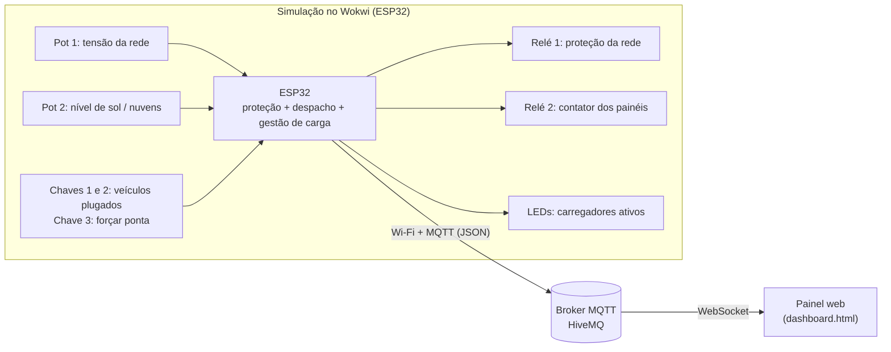

# Estação de Recarga Solar Inteligente para Veículos Elétricos

**Sprint 4 – Solução final integrada | Desafio Goodwe**

Simulação de uma estação de recarga **comercial** com dois carregadores de 22 kW, usina solar e bateria estacionária. Um ESP32 decide de onde vem cada kWh (sol, bateria ou rede), protege a instalação contra tensão fora da faixa e envia a telemetria por MQTT para um painel em tempo real. O projeto usa como referência produtos e conceitos da linha Goodwe (inversor híbrido, bateria, carregador HCA e monitoramento no estilo SEMS Portal).

## Equipe

| Nome | RM |
|---|---|
| Luiz Cesar Conti Salvador | 571305 |
| Victor do Prado Manzini | 572123 |
| Caio Marinho Pereira | 572873 |
| Ricardo Tunes Vaca | 555919 |
| Guilherme de Oliveira Santos | 572195 |

## Links

- **Vídeo técnico (YouTube, não listado):** https://youtu.be/_xbyp0m53f4
- **Projeto no Wokwi:** https://wokwi.com/projects/478315028949460993
- **Repositório:** https://github.com/LuizSalvador-GIT/SPRINT4_PYTHON

---

## 1. Visão geral

### Problema
Estações de recarga comerciais enfrentam três desafios: o **custo de demanda** (a rede cobra por pico de potência), o **horário de ponta** (energia mais cara) e a necessidade de **reduzir emissões** alimentando os veículos com energia limpa.

### Solução
Uma estação que combina geração solar, bateria e rede, com um algoritmo de despacho que:

1. **Prioriza o sol** para abastecer os veículos.
2. **Usa a bateria** para segurar picos e, na ponta, antes da rede.
3. **Respeita a demanda contratada** (limite de importação da rede) por meio de **gestão dinâmica de carga**.
4. **Protege a instalação**: desliga carregadores e painéis se a tensão da rede sair da faixa segura, e desconecta os painéis quando não há geração.
5. **Monitora tudo em tempo real** em um painel web, com indicadores de energia limpa, CO₂ evitado, economia e pico de demanda.

### Escopo da validação
A validação foi feita **em simulação** (Wokwi + painel web). O protótipo físico está em desenvolvimento e não foi usado nos resultados deste documento.

---

## 2. Arquitetura



### Camadas

| Camada | Componentes | Função |
|---|---|---|
| **Sensoriamento (simulado)** | 2 potenciômetros em ADC (pinos 35 e 34), 3 chaves (pinos 27, 14 e 13) | Tensão da rede, nível de sol, veículos plugados e ponta |
| **Processamento** | ESP32, código em C++ (Arduino) | Proteção, despacho de energia, gestão de carga, métricas |
| **Atuação** | Relé da rede (pino 26), relé dos painéis (pino 25), LEDs (pinos 18 e 19) | Desconectar, cortar painéis e sinalizar carregamento |
| **Comunicação** | Wi-Fi, MQTT (biblioteca PubSubClient), JSON | Telemetria a cada segundo |
| **Visualização** | `dashboard.html` (HTML, CSS, JavaScript, MQTT.js) | Fluxo de energia animado, gráfico, decisão em texto e indicadores |

### Escala simulada

| Parâmetro | Valor |
|---|---|
| Carregadores | 2 × 22 kW |
| Usina solar | 30 kW |
| Bateria estacionária | 30 kWh, carga e descarga até 15 kW, mínimo de 10% |
| Bateria do veículo | 60 kWh (carregamento reduz após 80%) |
| Demanda contratada (importação da rede) | 30 kW |
| Faixa segura de tensão | 176 a 242 V (80% a 110% de 220 V), com histerese (religa entre 187 e 233 V) |
| Corte dos painéis | Abre abaixo de 0,5 kW e reconecta acima de 1,0 kW |
| Tempo simulado | 1 s real = 15 min simulados (um dia em 96 s) |

---

## 3. Alinhamento ao desafio Goodwe

O projeto **não usa equipamentos Goodwe reais**. Ele **simula o comportamento** de uma estação construída com produtos e funções da marca, para demonstrar a lógica e a viabilidade da integração.

| O que foi simulado | Referência Goodwe | Observação |
|---|---|---|
| Carregador de 22 kW | Linha de carregadores HCA, com modelo de 22 kW (GW22K-HCA) | Dois carregadores de 22 kW simulados. Fonte consultada em distribuidores; confirmar no site oficial |
| Prioridade solar nos carregadores (`SOL_DIRETO`) | Carga por excedente solar (*surplus charging*) dos carregadores HCA em conexão com inversores Goodwe | Implementado: o sol abastece os veículos antes de bateria e rede. Simulação da lógica, sem comunicação real com inversor |
| Gestão de carga e limite da rede | Recursos de gestão de carga e excedente solar da geração HCA-G2 | Implementado: limite de importação de 30 kW e redução proporcional da potência dos carregadores (`LIMITANDO_POTENCIA`) |
| Carga só com sol ou reforço pela rede | Modos de carga configuráveis no app SEMS+, com comunicação entre carregador, inversor e bateria | Simulado pela ordem sol, rede e bateria (e bateria antes da rede na ponta). Os modos configuráveis do app SEMS+ não foram implementados |
| Painel em tempo real | Acompanhamento das cargas no SEMS Portal e no app | Implementado: painel próprio via MQTT que imita o conceito, sem uso da API real do SEMS Portal |
| Proteções (relé da rede, anti-ilhamento) | Proteções integradas do carregador (corrente residual DC, parada de emergência) e do inversor | Implementado: relé da rede com histerese e contator dos painéis. Confirmar as proteções do inversor escolhido no datasheet |
| Inversor híbrido e bateria | Linha híbrida (solar + bateria + rede) | Simulados como usina de 30 kW e bateria de 30 kWh (até 15 kW). Modelos a confirmar no datasheet |
| Evolução para equipamento real | Comunicação do carregador G2 por RS485, LAN ou Wi-Fi (Modbus) | Próximo passo, não implementado |

### Alinhamento à disciplina

O projeto aplica, de forma integrada, os conceitos trabalhados na disciplina:

- **Sensores e leitura analógica (ADC):** a tensão da rede e o nível de sol são lidos pelo conversor analógico-digital do ESP32, e as chaves representam a presença dos veículos.
- **Atuadores:** relés acionados pelo ESP32 fazem a proteção da rede e o corte dos painéis, e LEDs sinalizam os carregadores ativos.
- **Automação baseada em regras:** o despacho de energia segue prioridades (sol, bateria e rede), com gestão de carga, regras por horário e histerese nas proteções para evitar acionamentos repetidos.
- **Conectividade e IoT:** o ESP32 usa Wi-Fi e o protocolo MQTT (publicação e assinatura) para enviar a telemetria em formato JSON.
- **Visualização de dados:** um painel web mostra o fluxo de energia, a decisão do sistema, gráficos e indicadores de impacto em tempo real.
- **Simulação de hardware:** a validação foi feita no Wokwi, o que permitiu testar o sistema completo sem o protótipo físico.

---

## 4. Lógica de decisão

### Ordem de prioridade

| Situação | Ordem de abastecimento dos veículos |
|---|---|
| **Fora de ponta** | Sol → Rede (até a demanda contratada) → Bateria |
| **Horário de ponta (18h às 21h)** | Sol → Bateria → Rede |
| **Sobra solar** | Bateria (até o limite de carga) → Exportação para a rede |
| **Pedido maior que o disponível** | Gestão de carga: reduz a potência dos carregadores proporcionalmente (`LIMITANDO_POTENCIA`) |

### Proteções
- **Tensão fora da faixa segura:** o relé da rede abre, os carregadores desligam e os painéis são desconectados (anti-ilhamento). Religa com histerese.
- **Sem geração solar:** o contator dos painéis abre, e bateria e rede assumem.
- **Carregamento realista:** o pedido de cada veículo cai quando a bateria passa de 80%.

### Modos reportados
`SOL_DIRETO`, `COMPLEMENTA_COM_REDE`, `USA_BATERIA`, `LIMITANDO_POTENCIA`, `OCIOSO_CARREGA_BATERIA`, `OCIOSO_EXPORTA`, `OCIOSO`, `PROTECAO_ATIVA`.

### Curva solar
A geração é o **nível de sol** (potenciômetro, 0 a 100%) multiplicado por uma curva senoidal do dia (zero antes das 6h e depois das 18h, pico ao meio-dia).

---

## 5. Como executar

1. **Simulação:** crie um projeto ESP32 no [Wokwi](https://wokwi.com) e cole `diagram.json`, `sketch_5.ino` (na aba `sketch.ino`, nome obrigatório no Wokwi) e `libraries.txt`. Rode com **Start**.
2. **Painel:** abra `dashboard.html` no navegador (arquivo local, com internet) com a simulação rodando.
3. **Teste sem o Wokwi:** no rodapé do painel, o botão **Simular dados** gera um dia completo com a mesma lógica.
4. **Tópico MQTT:** a constante `TOPICO` no sketch e no painel precisa ser **igual**. Use um nome exclusivo do grupo, porque o broker é público.

### Controles da simulação

| Controle | Função |
|---|---|
| Potenciômetro esquerdo | Tensão da rede (≈ 73% do giro = 220 V) |
| Potenciômetro direito | Nível de sol ou nuvens |
| Chaves 1 e 2 | Plugam veículo no carregador 1 e 2 |
| Chave 3 | Força o horário de ponta (opcional) |

---

## 6. Resultados

### Cenários testados

| Cenário | Resultado observado |
|---|---|
| Um veículo, sol alto | `SOL_DIRETO`: carregamento só com energia solar |
| Sem veículos, com sol | Sol carrega a bateria; bateria cheia, sobra exportada |
| Dois veículos, sol baixo | Rede e bateria completam; bateria segura os picos acima da demanda |
| Bateria no mínimo e pedido acima do limite | `LIMITANDO_POTENCIA`: gestão de carga reduz a potência |
| Noite | Painéis desconectados; rede e bateria abastecem os veículos |
| Tensão da rede fora de 176 a 242 V | Relé abre, carregadores e painéis desligam; religa com histerese |

### Resultados quantitativos (um dia simulado)

| Indicador | Valor |
|---|---|
| Energia entregue aos veículos | 133,8 kWh |
| Energia limpa (solar direta ou via bateria) | 49 % |
| Autonomia estimada entregue | 803 km |
| CO₂ evitado | 2,64 kg |
| Economia estimada | R$ 131,86 |
| Pico de demanda da rede | 22 kW (limite: 30 kW) |
| Sessões de recarga | 4 |

### Imagens do sistema em funcionamento

Prints do circuito no Wokwi, do terminal serial, do painel durante a operação e dos resultados acumulados.


### Resultados qualitativos
- O painel torna a decisão do sistema legível (fluxo animado e frase de decisão).
- A gestão de carga evita ultrapassar a demanda contratada, protegendo o custo da instalação.
- A proteção com histerese evita desligamentos repetidos perto dos limites de tensão.

---

## 7. Avaliação crítica

### Sustentabilidade
- **Energia limpa:** priorizar o sol e armazenar a sobra na bateria aumenta o uso de energia renovável nos veículos.
- **Eficiência:** a bateria reduz picos de demanda e desloca consumo da ponta.
- **Emissões:** o CO₂ evitado é calculado com o fator médio da rede brasileira. Como esse fator é baixo, o benefício em CO₂ da energia solar é modesto. O ganho mais expressivo está em custo e gestão de demanda, e na troca de combustível fóssil por eletricidade.

### Relevância social e ambiental
A solução apoia a eletrificação do transporte ao reduzir o custo de operação de estações de recarga, o que pode tornar a infraestrutura viável em mais locais. Ao priorizar energia solar e usar a bateria para aliviar a rede nos horários de pico, também contribui para uma rede elétrica mais estável.

### Inovação
Algoritmo de despacho com prioridades por horário, gestão dinâmica de carga, proteção com histerese, corte automático dos painéis, painel web em tempo real com decisão explicada e simulação completa de um dia.

### Limitações
- Validação feita **só em simulação**; o protótipo físico está em desenvolvimento.
- Entradas simuladas por potenciômetros e chaves, sem sensores reais de tensão ou corrente.
- Sem integração real com a API do SEMS Portal ou comunicação Modbus.
- Tarifas, limites, fator de emissão e autonomia são **premissas** (seção 8).
- Broker MQTT público, adequado para demonstração, mas não para produção.

### Próximos passos
Integração com inversor e carregador reais via Modbus, uso de sensores de tensão e corrente (por exemplo, módulos de medição), previsão de geração solar, tarifa dinâmica, opção de **zero injeção** (limitar a geração em vez de exportar) e integração com assistente virtual (por exemplo, consultar o estado da estação e o horário de ponta por voz).

---

## 8. Premissas e valores a confirmar

| Premissa | Valor usado | Observação |
|---|---|---|
| Fator de emissão da rede | 0,04 kg CO₂/kWh | Arredondado a partir do fator médio do SIN em 2023 (38,5 kg/MWh, MCTI) |
| Tarifa fora de ponta | R$ 0,80/kWh | Valor ilustrativo; ajustar para a distribuidora |
| Tarifa na ponta | R$ 2,00/kWh | Valor ilustrativo; ajustar para a distribuidora |
| Horário de ponta | 18h às 21h | Confirmar na distribuidora |
| Demanda contratada | 30 kW | Premissa do cenário |
| Autonomia do veículo | 6 km/kWh | Estimativa |
| Limites de tensão | 80% a 110% de 220 V | Confirmar na norma de conexão (ABNT NBR 16149) e regra da distribuidora |
| Potências e capacidades | 22 kW, 30 kW, 30 kWh | Confirmar nos datasheets dos modelos Goodwe escolhidos |

---

## 9. Referências e ferramentas

### Referências Goodwe (consultadas em distribuidores; confirmar no site oficial da Goodwe)
- Carregador GW22K-HCA: https://shop.krannich-solar.com/en-se/EV-Charger-GW-22K-HCA/8253003
- Carregador GW7K-HCA G2 (gestão de carga, excedente solar, RS485, LAN e Wi-Fi): https://shop.krannich-solar.com/de-en/e-mobility/ac-charging-stations/71716/ev-charger-gw-7k-hca-g2
- Carregador GW22K-HCA-20 (modos no app SEMS+): https://www.solartraders.com/en/products/accessories/e-mobility/goodwe-gw22k-hca-20
- Site oficial da Goodwe (inversores híbridos e baterias): https://www.goodwe.com. Os modelos exatos de inversor e bateria não foram fixados; a simulação usa valores de referência (usina de 30 kW e bateria de 30 kWh).

### Fator de emissão de CO₂
- Fator médio de emissão do Sistema Interligado Nacional (SIN), divulgado pelo MCTI: 38,5 kg CO₂/MWh em 2023 (https://www.osetoreletrico.com.br/?p=159478). A simulação usa 0,04 kg CO₂/kWh, arredondado a partir desse valor. O fator varia mês a mês (por exemplo, 28,9 kg/MWh em abril de 2025, segundo o SIRENE/MCTI), então o CO₂ evitado é uma estimativa.

### Normas e regulamentação
- ABNT NBR 16149: Sistemas fotovoltaicos (FV) – Características da interface de conexão com a rede elétrica de distribuição. Os limites de tensão da simulação (80% a 110% de 220 V) são uma premissa inspirada nessa norma e devem ser confirmados nela e nas regras da distribuidora.

### Premissas do cenário (não extraídas de fonte oficial)
- Tarifas de R$ 0,80/kWh (fora de ponta) e R$ 2,00/kWh (ponta): valores ilustrativos, definidos para demonstrar a lógica. Para um caso real, usar a tarifa da distribuidora.
- Horário de ponta de 18h às 21h: janela de três horas escolhida como exemplo. Na prática, é definida por cada distribuidora.
- Demanda contratada de 30 kW: premissa do cenário.
- Autonomia de 6 km/kWh: estimativa típica para veículos elétricos de passeio, usada apenas para ilustração.

### Ferramentas e tecnologias
- Wokwi (simulação de ESP32): https://wokwi.com
- PubSubClient (MQTT para Arduino/ESP32): https://github.com/knolleary/pubsubclient
- MQTT.js (cliente MQTT no navegador): https://github.com/mqttjs/MQTT.js
- Broker público HiveMQ: https://www.hivemq.com

---

## 10. Estrutura do repositório

```
.
├── README.md
├── wokwi/
│   ├── sketch_5.ino        (colar na aba sketch.ino do Wokwi)
│   ├── diagram.json
│   └── libraries.txt
├── dashboard/
│   └── dashboard.html
├── docs/
│   ├── prints/             (circuito, terminal, painel)
│   └── arquitetura.png     (opcional)
└── versao_residencial_v1/  (primeira versão, foco residencial)
```
